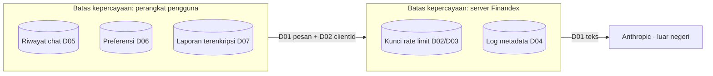

# C01 — Inventaris & peta data pribadi

> © 2026 Dea Saka Kurnia Putra. All rights reserved.

| Kontrol dokumen | |
|---|---|
| ID dokumen | C01 |
| Judul | Inventaris & peta data pribadi |
| Versi | 0.1.0 (= versi aplikasi) · commit `fd1db6c` |
| Tanggal | 2026-10-25 |
| Status | Draf |
| Klasifikasi | Internal |
| Pemilik | Dea Saka Kurnia Putra |
| Penyusun | Dibangkitkan oleh `scripts/compliance/*` (Claude Code) dari sumber kebenaran repo |
| Penyetuju | [KONFIRMASI] — penyetuju dokumen belum ditetapkan |
| Lingkup | Semua elemen data yang diproses atau disimpan |
| Standar acuan | UU 27/2022 (UU PDP); ISO/IEC 29100 |
| Dokumen terkait | C02, C04, C10 |

**Riwayat perubahan**

| Versi | Tanggal | Perubahan |
|---|---|---|
| 0.1.0 | 2026-10-25 | Versi pertama, dibangkitkan dari sumber kebenaran repo. |

Pengendali: Finandex (pemilik: Dea Saka Kurnia Putra) [KONFIRMASI identitas & alamat pengendali].

| ID | Elemen data | Lokasi | Tujuan | Peran | Retensi | Bukti |
|---|---|---|---|---|---|---|
| D01 | Isi pesan chat (≤ 20 pesan terakhir), bahasa, Dex, konteks tampilan — dapat memuat data yang diketik pengguna (nama, keuangan, kronologi korban) | perangkat → server Finandex (memori, tidak disimpan) → Anthropic | menghasilkan jawaban chat | Finandex pengendali; Anthropic & Vercel prosesor | server: tidak disimpan (hanya selama permintaan); penyedia LLM: sesuai ketentuan penyedia [KONFIRMASI] | `server/chat/orchestrator.ts @ fd1db6c` |
| D02 | clientId (UUID acak lokal) | perangkat; dikirim bersama permintaan chat | pembatasan laju | pengendali | perangkat: sampai direset pengguna; server: kunci rate limit ber-TTL | `src/lib/store.ts#L65 @ fd1db6c` |
| D03 | Alamat IP | server (memori / Upstash Redis bila dikonfigurasi) | pembatasan laju & pencegahan penyalahgunaan | pengendali; Upstash & Vercel prosesor | TTL kunci: 600 detik (jendela) dan 1 hari (harian) | `server/security/ratelimit.ts#L54 @ fd1db6c` |
| D04 | Log operasional: requestId, Dex, tool, latensi, token, kode galat (tanpa isi pesan) | log platform Vercel | operasi & penanganan galat | pengendali; Vercel prosesor | [KONFIRMASI] default 30 hari | `server/handler.ts#L148 @ fd1db6c` |
| D05 | Riwayat chat (≤ 50 percakapan per Dex) | perangkat (IndexedDB) | melanjutkan percakapan | tidak diproses Finandex | sampai dihapus pengguna | `src/lib/history.ts @ fd1db6c` |
| D06 | Watchlist, preferensi tema/bahasa/aksesibilitas, status persetujuan + versi kebijakan | perangkat (localStorage) | preferensi & bukti persetujuan lokal | tidak diproses Finandex | sampai direset pengguna | `src/lib/store.ts#L19 @ fd1db6c` |
| D07 | Isian "Siapkan Laporan" (kronologi korban penipuan, nominal, kanal) | perangkat (IndexedDB, AES-GCM, kunci tidak dapat diekspor) | menyiapkan laporan ke kanal resmi | tidak diproses Finandex | 30 hari otomatis, kecuali pengguna memilih simpan | `src/lib/secure-store.ts#L9 @ fd1db6c` |
| D10 | Jawaban kuesioner profil risiko (tujuan, jangka waktu, dana darurat, porsi kekayaan, penghasilan, pengalaman, reaksi saat rugi, kerugian yang dapat diterima) + hasil profil | perangkat (localStorage) | mencocokkan kelas aset secara edukatif | tidak diproses Finandex | sampai diulang atau direset pengguna | `src/shared/risk-profile.ts @ fd1db6c` |
| D08 | Data pasar/regulasi yang dibuka (cache) | perangkat (Cache Storage) | pemakaian offline | bukan data pribadi | sampai cache dibersihkan | `vite.config.ts @ fd1db6c` |
| D09 | Data unduhan/pembaruan aplikasi (akun store pengguna) | Apple App Store, Google Play, GitHub Releases | distribusi aplikasi | store = pengendali mandiri | sesuai kebijakan store | `capacitor.config.ts @ fd1db6c` |

Tidak ada analytics pihak ketiga dan tidak ada akun.
