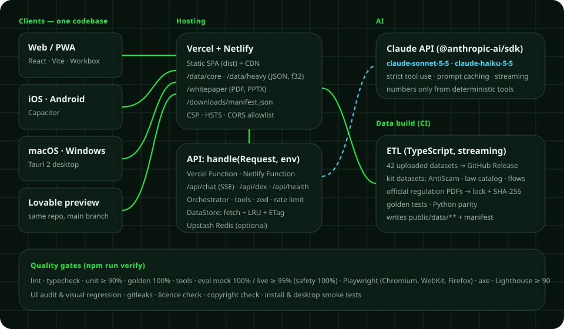
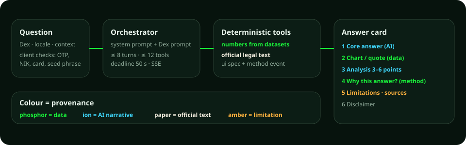

# Finandex
## Whitepaper for a financial market indexing insights platform with 29 data-grounded chatbots

Version 1.0 · 23 October 2026 · Prepared by **Dea Saka Kurnia Putra**

> Finandex presents historical data and legal information for information and education. It is not investment advice, not financial or legal advice, and is not affiliated with OJK, Bank Indonesia, IASC, Satgas PASTI, the Indonesian National Police, any exchange, or any trademark owner.

---

## 1. Executive summary

Finandex is an insights app for global and Indonesian financial market indices whose flagship feature is the **chatbot**. It consists of **29 chatbots called "Dex"** in **8 categories**. Each Dex has its own menu, features, logo, and dataset, so a question about NASDAQ stocks, Indonesian mutual funds, the rupiah, DeFi, global salaries, or banking law is answered by an assistant that actually holds the data.

Three things set Finandex apart:

1. **Numbers come only from data.** The language model may not calculate or recall numbers. Every number comes from a deterministic *tool* that reads the dataset; results are tested against *golden fixtures* recomputed by a Python reference implementation.
2. **Every answer can be checked.** Answers appear as a card: core answer, chart, analysis, a **"Why this answer?"** panel (data, formula, cleaning rules, tools called), limitations, and sources.
3. **Law and consumer protection.** **My LAIwyer** answers general law, **FinLAIwyer** answers financial and banking law with a focus on scam victims, and **AntiScamDex** adopts public information from the Indonesia Anti-Scam Centre (IASC), Satgas PASTI, OJK, and Bank Indonesia. Legal quotations are taken only from verified official texts.

One *source code* produces a web app/PWA, iOS and Android apps (Capacitor), and macOS and Windows desktop apps (Tauri 2), deployed to GitHub, Vercel, Netlify, and Lovable.

## 2. Background and problem

- **Financial data is scattered and hard to read.** Prices, fundamentals, macro, crypto, and socio-economic data live in different sources and formats with uneven quality (fake price spikes, stitched sources, duplicates, samples, synthetic data).
- **AI answers are often unverifiable.** General chatbots can state convincing numbers without a source, a data date, or a method.
- **Financial scams are rising.** From IASC's start on 22 November 2024 to 2026-09-30, IASC received **702,342 reports**, **1,372,483 accounts** were reported, **702,833 accounts** were blocked, **IDR 811.1 billion** of victims' funds were blocked, and **IDR 207.16 billion** was returned (source: OJK press conference of 5 October 2026, reported by Kontan and Bisnis.com).
- **Legal literacy is limited.** Victims often do not know the order of steps (bank, IASC, police report), their rights against banks or payment providers, or the legal basis — especially after the new Criminal Code (Law 1/2023) and new Criminal Procedure Code (Law 20/2025) took effect on 2 January 2026, together with Law 1/2026 on Criminal Penalty Adjustment.

## 3. Vision and product principles

Finandex's vision: **to be an honest index map** where anyone can ask about markets, the economy, and financial law and see the evidence behind the answer.

Principles that are tested automatically:

| Principle | What it means in the app |
|---|---|
| Numbers only from data | Every number comes from a tool result in the same turn; never from model memory |
| One analytics implementation | Formulas live only in `src/shared/analytics/**`, used by ETL, server, and client; identical to the Python reference |
| Honest about time | Data is not real-time; every number shows its *as-of* date |
| Not advice | No buy/sell recommendations, price predictions, or legal advice |
| Privacy by design | No accounts in v1; chat history on device; social media author identities dropped |
| A sample stays a sample | Sampled and synthetic datasets are always labelled |
| Legal text = official text | Quotes only from verified official documents; summaries always labelled as summaries |
| No impersonation of institutions | No institution logos, no report form "on behalf of" any institution |
| Design = identity | The whole app uses the "Index Constellation" design system |
| Copyright | © Dea Saka Kurnia Putra on splash, footer, About, exports, and metadata |

## 4. Feature map: 29 Dex in 8 categories

The home screen shows every Dex as the **Index Constellation** (an interactive star map) and as an accessible grid. Dex are grouped by similarity of chatbot function:

| Category | Similar chatbot function | Dex |
|---|---|---|
| **Global Markets & Equities** | Price, return, risk, and ranking analysis of global assets, stocks, and IPOs | Finandex AI, NASDAQDex, SnP500Dex, CommerceDex, IPODex |
| **Indonesian Markets & Economy** | IHSG, Indonesian stocks, the rupiah, Bank Indonesia macro, and mutual funds | IDFinanDex, RupiahDex, IDXDex, ReksaDex |
| **Crypto & Global Macro** | Crypto/DeFi assets, central bank balance sheets, and world inflation | CryptDex, CentralBankDex, InflationDex |
| **Startups, VC & Companies** | Funding, investors, co-investment networks, and company directories | StartupDex, VCDex, VCNetworkDex, OpenCompanyDex |
| **Cost of Living, Work & Household** | Salaries, city cost of living, house prices, and online food prices | SalaryDex, CostLivingDex, IDHousingDex, IDFoodDeliveryDex |
| **Social & Development** | Multidimensional poverty and news coverage of social issues | PovertyDex, PopulationDex, HomelessnessDex, HousingDex |
| **Sentiment & Personal Finance** | Public sentiment and discussion about fintech and personal finance | FintechDex, PersonalFinanDex |
| **Law & Consumer Protection** | General law and financial/banking law Q&A, plus rapid response for scam victims | My LAIwyer, FinLAIwyer, AntiScamDex |

Every Dex always has a **Chat** tab (first) and a **Data** tab (last: source files, coverage, *as-of*, cleaning rules, quality, licence). The **"About this feature"** button on each Dex and the `/panduan` page explain each tab; the chatbot also answers "what can I ask here?" from the same guide. The full catalogue is in Appendix A.

## 5. Data: sources, cleaning, and verification

### 5.1 Data sources
- **42 uploaded dataset files** (CSV, ZIP, Parquet, notebooks, PDF) with SHA-256 checksums in a manifest. Coverage includes 34 global assets since 2000, 500 NASDAQ stocks since 1962, Indonesia Stock Exchange stocks 2000–2024, daily USD/IDR since 2001, Indonesian mutual funds, crypto & DeFi, central bank balance sheets, salaries, startups, VC, housing, inflation, multidimensional poverty, and news coverage.
- **Kit-authored datasets**: the AntiScamDex knowledge base (23 dated sources), the regulation catalogue (41 documents: 11 general law, 30 financial & banking), 10 Guided Consultation flows, and the Feature Guide.
- **Official regulation documents** are downloaded at build time only from government domains (JDIH BPK, peraturan.go.id, OJK, BI, ministry JDIH), verified by title and anchor phrases, and locked with SHA-256.

### 5.2 Documented cleaning
Examples of enforced, tested rules: fake price spikes that reverse the next day are removed; "systemic" dates where data sources were stitched set `reliable_from`; extreme moves are flagged and excluded from aggregates; FX bad prints are detected with a rolling median; holiday carry-forward values are not new observations; World Bank aggregates are not countries; double-counted DeFi protocol TVL is never summed as a market total; synthetic data is always labelled; cumulative IASC series may never decrease and headline-only figures are marked differently.

### 5.3 Golden fixtures and parity
The Python reference implementation (pandas, numpy, pyarrow, poppler) recomputes every number from raw data and writes *golden fixtures*. The TypeScript ETL must reproduce them (relative tolerance 1e-6). CI runs Python ↔ TypeScript parity. The chatbot evaluation set contains **161 questions** with expected answers, including safety items.

Figure 1. Finandex architecture.

## 6. Chatbot engine

### 6.1 Answer flow
1. The client checks the message before sending: seed phrases, private keys, card numbers, national ID numbers (NIK), OTP/PIN codes, and account numbers are blocked.
2. The server assembles the global *system prompt* + the Dex prompt + a dataset card (with *prompt caching*), registers the Dex's tools with `strict` schemas, then runs a loop of at most 8 turns, 12 tool calls, and a 50-second deadline.
3. Deterministic tools read data and return results, a chart specification, and a `method` event (formula, steps, rows used, flags).
4. The client receives an SSE stream (`meta`, `status`, `text`, `artifact`, `method`, `citation`, `done`, `error`) and builds the answer card.

Figure 2. From question to answer card.

### 6.2 Answer format
The answer card always follows this order: core answer → visual chart (chosen by the tool by rule: line for trends, bar for rankings, heatmap for correlation, quote card for law, numbered steps for Guided Consultation) → 3–6 analysis points → the "Why this answer?" panel → limitations and sources → disclaimer. The justification panel is generated from tool metadata, not from the model's internal reasoning.

### 6.3 Conversation safety
Dataset content (reviews, news, legal quotes) enters only as tool results and is treated as data, not instructions. The chatbot refuses to reveal its *system prompt*, refuses investment recommendations or legal advice, never asks for identity data, and answers questions about the app's creator with "Finandex is designed and developed by Dea Saka Kurnia Putra."

## 7. Law: My LAIwyer and FinLAIwyer

Law is split into **two question-and-answer apps** with their own datasets, menus, logos, and history, on the same legal text engine. Both can also be installed as separate apps (PWA `/apps/mylaiwyer/` and `/apps/finlaiwyer/`).

| | My LAIwyer | FinLAIwyer |
|---|---|---|
| Focus | General law: constitution, criminal law & procedure, basic civil law, legal aid, hierarchy of regulations | Financial & banking law: scam victims, disputes with banks/payment providers, online lending, crypto assets |
| Corpus | 11 documents (1945 Constitution original & amended, Criminal Procedure Code 1981 & 2025, Law 1/1946, Criminal Code Law 1/2023, Law 1/2026, Civil Code, Legal Aid Law, Small Claims Regulation, Law on Making Regulations) | 30 documents (Financial Sector Law P2SK, OJK Law, Banking Law, Bank Indonesia Law, Fund Transfer Law, Anti-Money Laundering Law, Personal Data Protection Law, Electronic Information & Transactions Law, OJK consumer protection regulation 22/2023, OJK dispute resolution, anti-fraud, online lending, and crypto regulations, BI Regulation 6/2026, and more) |
| Interaction | Free questions + Guided Consultation (questioned by police, damages claim, hierarchy) | Free questions + Guided Consultation (7 flows: just scammed, mistaken incoming transfer, loan harassment, fake investment, unauthorised transaction, impersonation of institutions, rejected complaint) |

Rules that make legal answers trustworthy:
- **Quotes only from official text** that has been downloaded and verified. If a document is not yet available, the chatbot uses the catalogue summary with the fixed label "Catalogue summary (not a quotation)".
- **Document status is always stated**: in force, amended, revoked, or with penalties adjusted by Law 1/2026. The catalogue deliberately does not store penalty amounts for sectoral laws.
- **Clear role limits**: legal information, not legal advice; no assessment of chances of winning; real cases are referred to advocates, legal aid institutions (LBH), OJK Contact 157, BI 131, or LAPS SJK.

## 8. AntiScamDex: adopting IASC public information

AntiScamDex turns public information from IASC, Satgas PASTI, OJK, and Bank Indonesia into interactive features, without imitating or replacing any official service:

- **Just scammed** — two questions (when and how) then immediate steps: contact your bank through official channels, report at `iasc.ojk.go.id`, file a police report, secure evidence, report the account and number at cekrekening.id and aduannomor.id.
- **Prepare a report** — an offline wizard that organises data and a timeline to match the IASC form; entries are stored encrypted on the device only and are never sent to the server.
- **Handling statistics** — as of 2026-09-30: 702,342 reports (334,756 filed via financial institutions, 367,586 directly by victims); 702,833 accounts blocked (51.21% of those reported); IDR 207.16 billion returned (25.54% of blocked funds). Satgas PASTI, 1 Jan–30 Sep 2026: 35,438 complaints about illegal entities; 1,222 entities stopped.
- **Know the scams** (11 scam types + red flags + quiz), **Official channels** (11 channels), **Prevent & evidence**.

Every number shows its cut-off date and source; numbers that come only from news headlines are marked differently; when two outlets report different numbers, both are shown.

## 9. Full tech stack

The whole app is built from **one repository, one npm package at the root** (for Lovable compatibility), with TypeScript `strict` across frontend, backend, and ETL.

### 9.1 Frontend (web, PWA, and the base of the mobile/desktop apps)

| Layer | Technology | Role |
|---|---|---|
| UI framework | React 18+, TypeScript `strict` | Components, strict types (`noUncheckedIndexedAccess`, `exactOptionalPropertyTypes`) |
| Build tool | Vite | Dev server, code splitting, lazy-loaded Dex pages |
| Styling | Tailwind CSS + shadcn/ui (Radix) mapped to Finandex tokens | "Index Constellation" design tokens, accessible Radix primitives |
| Routing | React Router (data router) | Deep links `/dex/:dexId/:tab?/:entity?`, `/install`, `/whitepaper`, `/panduan` |
| Data fetching | TanStack Query | Cache, stale-while-revalidate, retry |
| UI state | Zustand | Theme, language, watchlist, compare tray |
| Validation | zod | One schema set for ETL, server, and client |
| i18n | i18next + react-i18next | Indonesian (default) & English |
| Charts | Apache ECharts (tree-shaken, lazy) + LTTB | Line, candlestick, bar, heatmap, treemap, graph, maps |
| Large tables | TanStack Table + TanStack Virtual | Sort, filter, virtualisation, CSV export |
| Local search | MiniSearch | Entity catalogue & legal articles (BM25) |
| Chat markdown | react-markdown + remark-gfm + rehype-sanitize | No raw HTML |
| PDF | pdfjs-dist | Original page preview for legal documents |
| Workers | Web Worker + Comlink, OffscreenCanvas | Large series parsing, ranking, the Index Constellation |
| Interaction | View Transitions API, @dnd-kit/core, CSS transitions | Compare tray, transitions that answer actions |
| Offline | vite-plugin-pwa (Workbox) + IndexedDB (idb-keyval) | Precached core data & whitepaper, cached heavy data |
| Fonts | Unbounded, IBM Plex Sans, IBM Plex Serif (@fontsource, self-hosted, OFL) | Headings, UI & tabular figures, official quotations |

### 9.2 Backend & API

| Layer | Technology | Role |
|---|---|---|
| Handler | `handle(Request, env)` on the Web Fetch API | Runtime-agnostic, no Node-only APIs |
| Adapters | Vercel Functions (`api/[[...route]].ts`), Netlify Functions (`netlify/functions/api.mts`, `config.path = "/api/*"`) | One server codebase for two platforms |
| Routes | `POST /api/chat` (SSE), `GET /api/dex`, `GET /api/health`, `GET /api/version`, `POST /api/feedback` | No endpoint accepts scam reports or identity data |
| Streaming | Server-Sent Events | `meta`, `status`, `text`, `artifact`, `method`, `citation`, `done`, `error`; 15-second heartbeat |
| Data | DataStore: `fetch(DATA_BASE_URL)` + LRU + ETag | Reads JSON & Float32 matrices from the CDN |
| Security | zod, CORS allowlist, strict CSP, HSTS, rate limiting (Upstash Redis REST, in-memory fallback), daily token budget | Validation & limits |
| Observability | Logs without message content (requestId, Dex, tool, latency, tokens) | Privacy |

### 9.3 AI layer

| Component | Choice | Notes |
|---|---|---|
| SDK | `@anthropic-ai/sdk` (Claude API) | Verified against the official documentation during implementation |
| Models | `claude-sonnet-5-5` (answers), `claude-haiku-5-5` (conversation titles, history summaries) | No `temperature`, `top_p`, `top_k` |
| Tool use | `strict` schemas, `tool_result` + `is_error` for failures | Deterministic, read-only tools with an 8-second timeout |
| Prompt caching | `cache_control` on the system prompt & tool definitions | Lower latency & cost |
| Limits | 8 turns, 12 tools, 50 seconds per request | Within Netlify's 60-second function limit |
| Evaluation | 161 items; mock 100%, live ≥ 95% and 100% of safety items | Includes conditional items for legal documents |

### 9.4 Data, ETL, and verification

| Component | Technology | Role |
|---|---|---|
| ETL | Streaming TypeScript (streaming CSV & ZIP, pure-JS Parquet parser) | Writes `public/data/core` (small, bundled) & `public/data/heavy` (on demand) |
| Formats | Columnar JSON + category dictionaries, little-endian Float32 matrices | Compact & fast |
| Input storage | GitHub Release `data-inputs-v1` (files > 100 MB are not allowed in the repo) | Re-fetched & verified by SHA-256 |
| Regulations | `fetch-regulations` → `regulations.lock.json` → Release `data-regulations-v1` | Official domains only; title & anchor verification |
| Reference | Python 3.12 + pandas + numpy + pyarrow + poppler-utils | Executable spec & golden fixtures |
| Parity | GitHub Actions `parity.yml` | Python = golden = TypeScript |

### 9.5 Mobile (iOS & Android)
**Capacitor** with official plugins: app, haptics, share, status-bar, splash-screen, preferences, network, keyboard, filesystem, browser; icons & splash via `@capacitor/assets`. Native apps bundle the core data for offline use and call the production API for chat. Native features: haptics, share sheet, Android back button, safe areas, keyboard that never covers the input, in-app browser for official channels.

### 9.6 Desktop (macOS & Windows)
**Tauri 2** (Rust) wraps the same web build: a universal `.dmg` (Apple silicon & Intel) signed with Developer ID and notarised, plus signed Windows `.exe`/`.msi` installers (x64 & ARM64). Plugins: updater (signed automatic updates), scoped dialog & fs, `finandex://` deep links, single instance, window state. Minimal capabilities (no shell, no unrestricted file access).

### 9.7 Install from the home screen
The `/install` centre and the "Install Finandex" band on the home screen adapt to the device: Android uses the PWA install prompt (and a Google Play link when available), iPhone/iPad shows an "Add to Home Screen" guide (and App Store/TestFlight), macOS and Windows show the desktop downloads with version, size, and SHA-256; in-app browsers are told to open Safari/Chrome; desktop shows a QR code for phones.

### 9.8 DevOps & deployment

| Component | Choice |
|---|---|
| Repository | GitHub; `main` = integration (Claude Code & Lovable), `release` = production (automatic fast-forward when CI is green) |
| Hosting | Vercel (production API & data), Netlify (mirror), Lovable (frontend preview & editor) |
| CI/CD | GitHub Actions: `ci.yml`, `parity.yml`, `promote.yml`, `android.yml`, `ios.yml`, `desktop.yml`, `regulations.yml`, `ui-review.yml`, `eval-live.yml`, `deploy-fallback.yml` |
| Runtime URLs | `VITE_API_BASE_URL` → same origin → `PRODUCTION_ORIGIN`, so Lovable previews, Netlify, and native apps always find the API |

### 9.9 Quality & testing
Vitest (≥ 90% coverage for `src/shared` & `server`), 100% golden tests, tool tests, chatbot evaluation, Playwright E2E on Chromium, WebKit, and Firefox (Pixel, iPhone, desktop viewports), @axe-core/playwright, Lighthouse CI (mobile ≥ 90), size-limit (initial JS ≤ 250 KB gzip), visual regression & design-token audit, user-task tests, desktop smoke tests, install-centre tests, gitleaks, license-checker (GPL/AGPL/SSPL rejected), and a copyright checker.

### 9.10 Security & privacy
Secrets live only on the server; client bundles are scanned for key patterns. CSP `default-src 'self'`, CORS allowlist (including Capacitor and Tauri origins), rate limiting, zod validation, read-only tools with no user-supplied URLs. No accounts and no third-party tracking; chat history, watchlist, and Prepare-a-report entries stay on the device. The privacy policy follows Indonesia's Personal Data Protection Law (Law 27/2022).

## 10. The "Index Constellation" design system

- **Signature element: the Index Constellation** on the home screen — one core (Finandex AI) and 29 Dex nodes in 8 category clusters; node brightness shows data freshness, the ring shows status. The layout is deterministic and keyboard-navigable.
- **Colour = provenance**: phosphor (the green from the personal logo) for numbers from datasets, ion (cyan) for AI narrative, paper (cream, serif type) for official text, amber for limitations, coral for negative values and danger.
- **Depth, not uniform cards**: layered panes with three radii by hierarchy and a graph-paper "index field" background.
- **Typography**: Unbounded (headings & large figures), IBM Plex Sans (UI & tabular figures), IBM Plex Serif (official quotations), 1.25 modular scale.
- **Interaction**: Index Search (⌘/Ctrl+K), Orbit Rail, "Narrative | Evidence" chat layout with an Evidence Pane, synchronised brush & crosshair, compare tray, "View as of date", Guided Consultation, Focus mode, keyboard shortcuts, haptics.
- **Accessibility**: WCAG 2.2 AA, full keyboard navigation, `prefers-reduced-motion`, high contrast, text up to 200%, text alternatives for charts.

## 11. Compliance, licensing, and trademarks

- Each dataset's licence is shown in its Data tab and on `/legal/data-sources`. CC BY-NC 4.0 datasets are for non-commercial use only; the `commercial` build profile hides them automatically.
- Laws and regulations are not protected by copyright in Indonesia (Law 28/2014 on Copyright, Article 42); Finandex still cites the official source and never alters the text.
- Names of institutions and third-party marks are used only as text references; no official institution logos are used.
- Dedicated disclaimers cover My LAIwyer, FinLAIwyer, AntiScamDex, CryptDex (bots & yield), and sample-based statistics Dex.
- Every release regenerates the compliance documentation set: technical documentation following ISO/IEC/IEEE standards (including 15289, 29148, 42010, 29119-3, ISO/IEC 25010, 27001, 42001), a **secure SBOM** in CycloneDX 1.7 + SPDX with the CISA 2026 minimum elements, Sigstore signatures, attestations, and VEX, and personal data protection documents under Law 27/2022 and Government Regulation 33/2026 (data map, records of processing, DPIA, privacy policy, data subject request and 3×24-hour breach notification procedures).

## 12. Limitations and risks

- Data is not real-time and may contain errors from its sources; some datasets are samples, one is synthetic, and some licences are not yet confirmed.
- Regulation documents that fail to download are shown as "awaiting document" until the owner uploads them.
- IASC statistics depend on OJK's monthly publications; updates add new observations without overwriting old ones.
- A language model can misinterpret; therefore numbers and quotations are limited to tool results, and safety evaluation must pass 100%.

## 13. Roadmap

1. Every new feature is built as a new Dex chatbot on uploaded datasets, using the `ADD_NEW_DEX_PROMPT.md` template.
2. Complete the legal documents still awaited (full old Criminal Code, HIR/RBg, Marriage Law, and more).
3. Store releases: App Store, Google Play, and optionally Mac App Store/Microsoft Store; an option for separate native My LAIwyer and FinLAIwyer apps.
4. Monthly IASC statistics updates and monthly regulation status monitoring.

## 14. Copyright and contact

© 2026 Dea Saka Kurnia Putra. All rights reserved. Finandex is designed and developed by Dea Saka Kurnia Putra — *A BRIGHTER TOMORROW THROUGH MEANINGFUL WORK*.

---

## Appendix A — Dex catalogue and functions

### Global Markets & Equities

#### Finandex AI

Global market assistant (indices, commodities, crypto, currencies); main chatbot and router to other Dex. Data as of: 2026-10-19.

*Functions (tabs):* Chat, Global markets, Compare, Correlation, Return calendar, Events, Data.

#### NASDAQDex

500 NASDAQ stocks, 1962–2026: returns, risk, descriptive technicals. Data as of: 2026-09-18.

*Functions (tabs):* Chat, Pulse, Screener, Growth lab, Technicals, Compare, Data.

#### SnP500Dex

233 S&P 500 stocks: total return, dividends, volume. Data as of: 2026-08-31.

*Functions (tabs):* Chat, Pulse, Dividends, Simulator, Screener, Volume & liquidity, Data.

#### CommerceDex

43 global e-commerce giants: prices, fundamentals, macro. Data as of: 2026-05-13.

*Functions (tabs):* Chat, Global map, Companies, Fundamentals, E-commerce index, Macro, Data.

#### IPODex

Global IPOs 2019–2026: India, US, UK and 100+ countries. Data as of: laporan s/d 2026-06-18.

*Functions (tabs):* Chat, Overview, Countries & exchanges, India SME vs Mainboard, Find IPOs, Data.

### Indonesian Markets & Economy

#### IDFinanDex

Indonesian multi-asset & macro: IHSG, USD/IDR, BI rate. Data as of: 2026-05-29.

*Functions (tabs):* Chat, Macro dashboard, Assets, Normalised trend, Correlation, Rate regimes, Data.

#### RupiahDex

Daily USD/IDR exchange rate since 2001 and historical conversion. Data as of: 2026-10-20.

*Functions (tabs):* Chat, Exchange rate, Historical converter, Yearly statistics, Events, Data.

#### IDXDex

Indonesia Stock Exchange stocks: prices, fundamentals, IPOs. Data as of: harga 2024-05-17; e-IPO s/d listing 2026-07-10.

*Functions (tabs):* Chat, Stocks, Fundamentals, IPO centre, Issuer directory, Data.

#### ReksaDex

Indonesian mutual funds: AUM, investment managers, performance. Data as of: 2026-05-29.

*Functions (tabs):* Chat, Industry, Investment managers, Find funds, Rankings, Custodian banks, Data.

### Crypto & Global Macro

#### CryptDex

Crypto: prices, market snapshot, DeFi, protocol fees, trading-bot education. Data as of: harga 2026-10-19; snapshot & DeFi 2026-10-20.

*Functions (tabs):* Chat, Crypto market, Historical prices, DeFi, Yield, Fees & revenue, Bots & AI agents, Data.

#### CentralBankDex

Central bank balance sheets & global liquidity (Fed, ECB, BoJ, 167 countries). Data as of: AS 2026-10-16; negara 2025.

*Functions (tabs):* Chat, G3 balance sheets, Rates & yield curve, Money supply, Country map, Regime labels, Data.

#### InflationDex

Inflation & cost of living across countries. Data as of: inflasi 2024 (sebagian 2022–2023).

*Functions (tabs):* Chat, Inflation map, Rankings, Cost of goods, Regions & income, Data.

### Startups, VC & Companies

#### StartupDex

Global startup funding rounds 2019–2026. Data as of: 2026-06-12.

*Functions (tabs):* Chat, Overview, Stages, Countries & sectors, Mega-rounds, Find rounds, Data.

#### VCDex

2026 directory of startup investors. Data as of: deal 2019–2026.

*Functions (tabs):* Chat, Directory, Rankings, Stage mix, Countries, Data.

#### VCNetworkDex

Co-investment network between VC investors. Data as of: 2019–2026.

*Functions (tabs):* Chat, Network graph, Top pairs, Investors, Data.

#### OpenCompanyDex

Directory of 100k companies (Open Company Database sample). Data as of: rilis Okt 2026 (REPORT.md).

*Functions (tabs):* Chat, Country map, Sectors & industries, Status & funding, Find companies, Data.

### Cost of Living, Work & Household

#### SalaryDex

Global salaries by skill & role (100k job-posting sample). Data as of: posting 2024-01 → 2026-06.

*Functions (tabs):* Chat, Benchmark calculator, Countries, Roles & seniority, Skills, Data.

#### CostLivingDex

Cost & quality of life in 148 cities (synthetic data). Data as of: survei 2024-06-15 (sintetis).

*Functions (tabs):* Chat, City rankings, City profile, Compare, Change 2023→2024, Data.

#### IDHousingDex

Indonesian subsidised & commercial housing (project listings). Data as of: tidak dicantumkan penyedia.

*Functions (tabs):* Chat, Overview, Provinces & cities, Project map, Specifications, Developers, Data.

#### IDFoodDeliveryDex

Price benchmark of 10k Indonesian food-delivery menus. Data as of: tidak dicantumkan penyedia.

*Functions (tabs):* Chat, Markup overview, Cities, Cuisines, Cloud kitchens, Find menus, Data.

### Social & Development

#### PovertyDex

Multidimensional Poverty Index (MPI) for 108 countries. Data as of: tahun survei per negara.

*Functions (tabs):* Chat, MPI map, Rankings, Dimensions, Compare, Data.

#### PopulationDex

Global news coverage of population topics 2019–2026. Data as of: berita s/d 2026-07-29.

*Functions (tabs):* Chat, Coverage trend, Geography, Themes & organisations, Research & patents, Provider findings, Data.

#### HomelessnessDex

Global news coverage of homelessness 2019–2026. Data as of: berita s/d 2026-07-29.

*Functions (tabs):* Chat, Coverage trend, Geography, Themes & organisations, Research & patents, Provider findings, Data.

#### HousingDex

Global news coverage of housing 2019–2026. Data as of: berita s/d 2026-07-23.

*Functions (tabs):* Chat, Coverage trend, Geography, Themes & organisations, Research & patents, Provider findings, Data.

### Sentiment & Personal Finance

#### FintechDex

Fintech product adoption & reviews from 14 platforms. Data as of: 2026-09-08.

*Functions (tabs):* Chat, Sentiment, Topics & aspects, Browse reviews, Trends, Data.

#### PersonalFinanDex

Personal finance & financial independence discussions. Data as of: 2026-09-16.

*Functions (tabs):* Chat, Sentiment, Topics, Browse discussions, Trends, Data.

### Law & Consumer Protection

#### My LAIwyer

General law Q&A: constitution, criminal law & procedure, basic civil law, legal aid. Data as of: katalog 2026-10-23; status dokumen per lock file.

*Functions (tabs):* Chat, Guided consultation, Legal sources, Browse articles, Compare versions, Glossary, Data.

#### FinLAIwyer

Indonesian financial & banking law Q&A — focused on scam victims and disputes with financial institutions. Data as of: katalog 2026-10-23; status dokumen per lock file.

*Functions (tabs):* Chat, Guided consultation, Financial regulation map, Browse articles, Status & changes, Complaint channels, Glossary, Data.

#### AntiScamDex

Adopts public information from IASC, Satgas PASTI, OJK & BI: emergency steps, report preparation, statistics, scam types. Data as of: statistik s/d 2026-09-30.

*Functions (tabs):* Chat, Just scammed, Prepare a report, Handling statistics, Know the scams, Official channels, Prevent & evidence, Data.

## Appendix B — Glossary

| Term | Meaning |
|---|---|
| Dex | A Finandex chatbot with its own dataset, menu, and logo |
| As-of | The latest date of the data used |
| Golden fixture | A correct value produced by the reference implementation, used as the test reference |
| Parity | Python, golden, and TypeScript producing identical results |
| SSE | Server-Sent Events, a server-to-client data stream |
| Tool | A deterministic function the chatbot calls to read data |
| Guided Consultation | Step-by-step Q&A with choices leading to actions and legal bases |
| PUJK | Financial services business actor (Indonesian regulatory term) |
| PJP | Payment service provider |
| LAPS SJK | Financial services alternative dispute resolution institution |
| PWA | Progressive Web App installable from the browser |

## Appendix C — Public information sources referenced

- Satgas PASTI / OJK — Satgas PASTI Terima 25 Ribu Pengaduan Aktivitas Keuangan Ilegal dan IASC Berhasil Blokir Dana Terkait Scam Rp724 Miliar (SP 16/STPASTI/VIII/2026) (2026-08-31), https://ojk.go.id/id/berita-dan-kegiatan/info-terkini/Pages/Satgas-PASTI-Terima-25-Ribu-Pengaduan-Aktivitas-Keuangan-Ilegal-dan-IASC-Berhasil-Blokir-Dana-Terkait-Scam-Rp-724-Miliar.aspx (diakses / accessed 2026-10-23)
- OJK — Indonesia Anti-Scam Centre Berhasil Kembalikan Rp161 Miliar Dana Masyarakat Korban Scam (SP 15/GKPB/OJK/I/2026) (2026-01-21), https://ojk.go.id/id/berita-dan-kegiatan/siaran-pers/Pages/IASC-Berhasil-Kembalikan-Rp161-Miliar-Dana-Masyarakat-Korban-Scam.aspx (diakses / accessed 2026-10-23)
- OJK — Tingkatkan Pelindungan Konsumen, Satgas PASTI Lakukan Soft Launching IASC (2024-11-25), https://ojk.go.id/id/berita-dan-kegiatan/info-terkini/Pages/Tingkatkan-Pelindungan-Konsumen-Satgas-Pasti-Lakukan-Soft-Launching-IASC.aspx (diakses / accessed 2026-10-23)
- OJK (portal IASC) — Indonesia Anti-Scam Centre — Pusat Penanganan Penipuan Transaksi Keuangan Indonesia (halaman utama, FAQ, kebijakan privasi) (tanpa tanggal / undated), https://iasc.ojk.go.id (diakses / accessed 2026-10-23)
- OJK — OJK Terbitkan Peraturan Penerapan Strategi Anti Fraud Bagi Lembaga Jasa Keuangan (SP-120/GKPB/OJK/VIII/2024) (2024-08-13), https://ojk.go.id/id/berita-dan-kegiatan/siaran-pers/Pages/OJK-Terbitkan-Peraturan-Penerapan-Strategi-Anti-Fraud-Bagi-Lembaga-Jasa-Keuangan.aspx (diakses / accessed 2026-10-23)
- Bank Indonesia — Perlindungan dan Pengaduan Konsumen (tanpa tanggal / undated), https://www.bi.go.id/id/layanan/pengaduan-konsumen/default.aspx (diakses / accessed 2026-10-23)
- Bank Indonesia — PBI Nomor 6 Tahun 2026 tentang Pelindungan Konsumen Bank Indonesia (halaman peraturan & FAQ) (2026-06-24), https://www.bi.go.id/id/publikasi/peraturan/Pages/PBI_062026.aspx (diakses / accessed 2026-10-23)
- Kontan — IASC Terima 702.342 Laporan Kasus Penipuan hingga September 2026 (2026-10-06), https://keuangan.kontan.co.id/news/iasc-terima-702342-laporan-kasus-penipuan-hingga-september-2026 (diakses / accessed 2026-10-23)
- Bisnis.com — OJK Terima 35.438 Pengaduan Entitas Keuangan Ilegal hingga September (2026-10-06), https://finansial.bisnis.com/read/20261006/55/2010326/ojk-terima-35438-pengaduan-entitas-keuangan-ilegal-hingga-september (diakses / accessed 2026-10-23)
- Kontan — IASC Terima 579.459 Laporan Kasus Penipuan per Mei 2026, Terbanyak di Pulau Jawa (2026-06-30), https://keuangan.kontan.co.id/news/iasc-terima-579459-laporan-kasus-penipuan-per-mei-2026-terbanyak-di-pulau-jawa (diakses / accessed 2026-10-23)
- Katadata — Korban Scam Tak Tahu Harus Lapor ke Mana? Kenali Layanan IASC (2026-06-30), https://katadata.co.id/finansial/keuangan/6a4324b291318/korban-scam-tak-tahu-harus-lapor-ke-mana-kenali-layanan-iasc (diakses / accessed 2026-10-23)
- Bisnis.com — BI Ingatkan Masyarakat Modus Penipuan Transaksi Digital (2026-09-25), https://finansial.bisnis.com/read/20260925/90/2007147/bi-ingatkan-masyarakat-modus-penipuan-transaksi-digital (diakses / accessed 2026-10-23)
- Hukumonline — Satgas PASTI Komitmen Berantas Investasi hingga Pinjol Ilegal (2023-12-01), https://www.hukumonline.com/berita/a/satgas-pasti-komitmen-berantas-investasi-hingga-pinjol-ilegal-lt6569aa714dab9/ (diakses / accessed 2026-10-23)
- Hukumonline (Klinik) — Panduan untuk Melaporkan Penipuan Online (2025-05-14), https://www.hukumonline.com/klinik/a/panduan-untuk-melaporkan-penipuan-online-lt656758061ec52/ (diakses / accessed 2026-10-23)
- Hukumonline (Klinik) — Penyelesaian Sengketa di Luar Pengadilan via LAPS SJK (2022-05-25), https://www.hukumonline.com/klinik/a/penyelesaian-sengketa-di-luar-pengadilan-via-laps-sjk-lt628e118797df9 (diakses / accessed 2026-10-23)
- ANTARA — Satgas PASTI: waspadai penipuan website mengatasnamakan IASC (tanpa tanggal / undated), https://www.antaranews.com/berita/4743805/satgas-pasti-waspadai-penipuan-website-mengatasnamakan-iasc/ (diakses / accessed 2026-10-23)
- https://kabar24.bisnis.com/read/20251208/15/1935112/sah-ruu-penyesuaian-pidana-resmi-menjadi-undang-undang
- https://ojk.go.id/id/berita-dan-kegiatan/info-terkini/Pages/Tingkatkan-Pelindungan-Konsumen-Satgas-Pasti-Lakukan-Soft-Launching-IASC.aspx
- https://ojk.go.id/id/berita-dan-kegiatan/siaran-pers/Pages/OJK-Terbitkan-Peraturan-Penerapan-Strategi-Anti-Fraud-Bagi-Lembaga-Jasa-Keuangan.aspx
- https://ojk.go.id/id/regulasi/Documents/Pages/POJK-23-2025-Perubahan-POJK-27-Tahun-2024-tentang-Penyelenggaraan-Perdagangan-Aset-Keuangan-Digital-Termasuk-Aset-Kripto/Abstrak%20POJK%2023%20Tahun%202025%20Perubahan%20Atas%20Peraturan%20Otoritas%20Jasa%20Keuangan%20Nomor%2027%20Tahun%202024%20tentang%20Penyelenggaraan%20Perdagangan%20Aset%20Keuangan%20Digital%20Termasuk%20Aset%20Kripto.pdf
- https://ojk.go.id/id/regulasi/Documents/Pages/Pelindungan-Konsumen-dan-Masyarakat-di-Sektor-Jasa-Keuangan/Abstrak%20POJK%2022%20Tahun%202023%20Pelindungan%20Konsumen%20dan%20Masyarakat%20di%20Sektor%20Jasa%20Keuangan.pdf
- https://ojk.go.id/id/regulasi/Pages/POJK-27-2024-AKD-AK.aspx
- https://ojk.go.id/id/regulasi/Pages/POJK-40-Tahun-2024-Layanan-Pendanaan-Bersama-Berbasis-Teknologi-Informasi.aspx
- https://ojk.go.id/id/regulasi/Pages/Pelindungan-Konsumen-dan-Masyarakat-di-Sektor-Jasa-Keuangan.aspx
- https://peraturan.bpk.go.id/Details/229798/uu-no-27-tahun-2022
- https://peraturan.bpk.go.id/Details/234935/uu-no-1-tahun-2023
- https://peraturan.bpk.go.id/Details/240203/uu-no-4-tahun-2023
- https://peraturan.bpk.go.id/Details/274494
- https://peraturan.bpk.go.id/Details/337302/uu-no-20-tahun-2025
- https://peraturan.bpk.go.id/Details/337869/uu-no-1-tahun-2026
- https://peraturan.bpk.go.id/Details/38547/uu-no-8-tahun-2010
- https://peraturan.bpk.go.id/Details/38588/uu-no-6-tahun-2009
- https://peraturan.bpk.go.id/Details/39133/uu-no-3-tahun-2011
- https://peraturan.bpk.go.id/Details/39257/uu-no-21-tahun-2011
- https://peraturan.bpk.go.id/Details/39655/uu-no-21-tahun-2008
- https://peraturan.bpk.go.id/Details/40458/uu-no-3-tahun-2004
- https://peraturan.bpk.go.id/Details/45288/uu-no-8-tahun-1999
- https://peraturan.bpk.go.id/Details/45332/uu-no-23-tahun-1999
- https://peraturan.bpk.go.id/Details/45486/uu-no-10-tahun-1998
- https://peraturan.bpk.go.id/Details/46599/uu-no-7-tahun-1992
- https://tirto.id/isi-pasal-tentang-pencucian-uang-tppu-dalam-uu-no-8-tahun-2010-gAXr
- https://www.bi.go.id/id/publikasi/peraturan/Documents/FAQ-PBI-062026.pdf
- https://www.bi.go.id/id/publikasi/peraturan/Pages/PBI_062026.aspx
- https://www.hukumonline.com/berita/a/kasus-salah-transfer--penggunaan-pasal-85-uu-transfer-dana-harus-hati-hati-lt61849edb377d1
- https://www.hukumonline.com/berita/a/kriteria-perkara-yang-bisa-dilakukan-gugatan-sederhana-lt636b8b1d00129
- https://www.hukumonline.com/berita/a/perkuat-perlindungan-konsumen--ini-11-substansi-pojk-22-2023-lt65a2863f13fda
- https://www.hukumonline.com/klinik/a/cara-menentukan-pasal-untuk-menjerat-pelaku-penipuan-online-lt5d1ad428d8fa3/
- https://www.hukumonline.com/klinik/a/penyelesaian-sengketa-di-luar-pengadilan-via-laps-sjk-lt628e118797df9
- https://www.jawapos.com/kasuistika/2601020137/kuhp-dan-kuhap-yang-baru-mulai-berlaku-2-januari-2026
